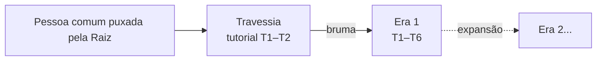
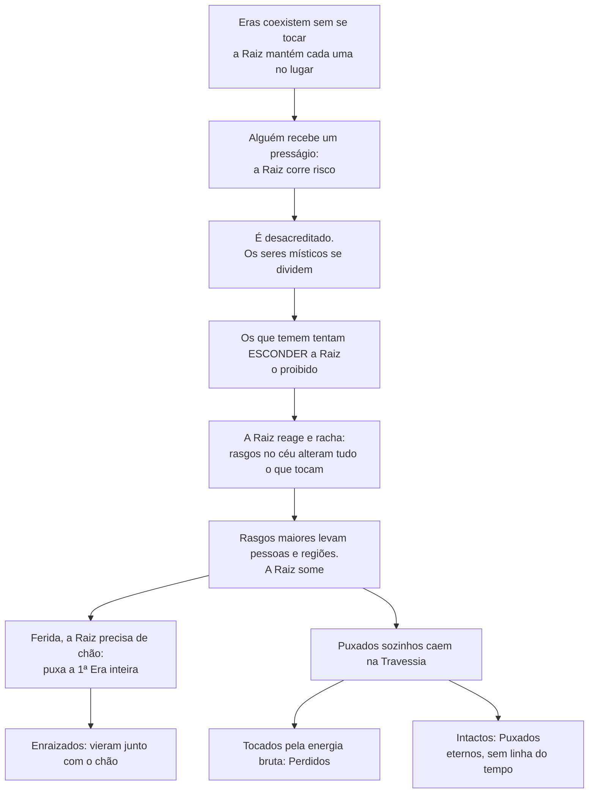
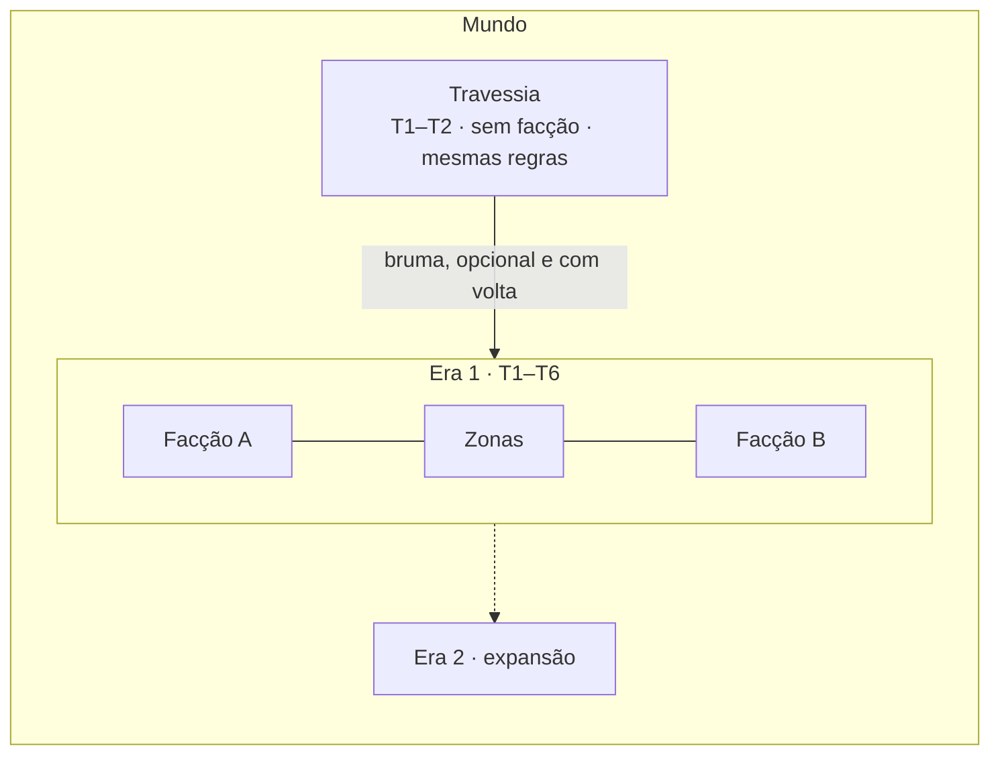
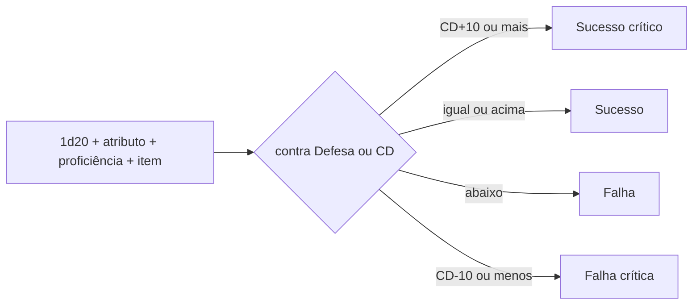
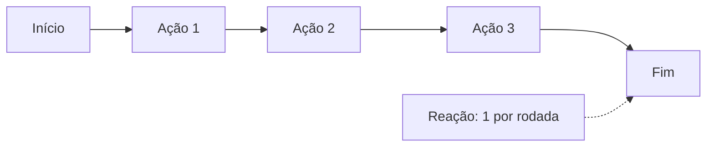
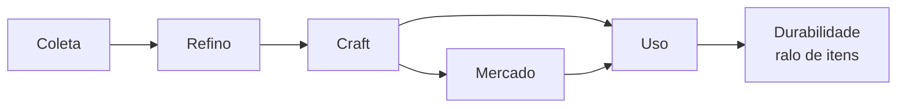
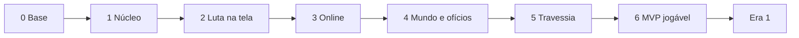
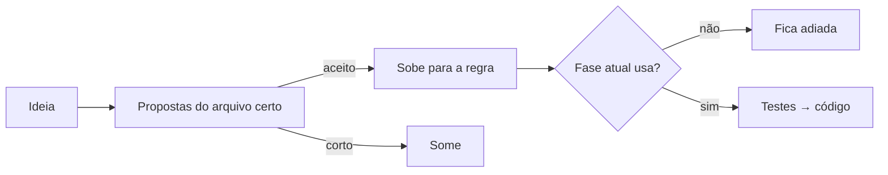

# Eras do Brasil — Consolidado (21/10/2026)

> Gerado pelo Claude em 21/10/2026, a pedido do Sidinei. O repositório `eras-do-brasil` continua vivo e não foi copiado para o acervo; este é o retrato dele no commit `f34acec`, junto com as decisões das conversas que ainda não estavam nos docs.

Retrato do jogo como está no repositório `eras-do-brasil` (commit `f34acec`, 21/10), mais as decisões das conversas.

**Legenda**
- ✅ **Decidido:** está nas seções de regra dos docs. Nenhum arquivo está `validado: true` ainda.
- 🟡 **Proposta:** ainda falta aceitar ou cortar.
- ❓ **Em aberto.**
- ⏸ **Adiado:** decidido, mas fora do MVP.
- ⚠️ **Conflito** a resolver.

---

## 1. O jogo

| | |
|---|---|
| Gênero | MMORPG sandbox, combate por turno, só PC (Steam) |
| Frase | "Você não foi escolhido. Ninguém aqui foi. Você se destaca pelo que faz, não pelo que é." |
| Público | Quem quer MMORPG, mas tem pouco tempo ou é interrompido |
| Motivação | Ter um MMORPG feito por mim e ver um mundo funcionando inteiro. For fun. |
| Referências | **Albion** (progressão, build, "você é o que veste", economia, tiers) · **Pathfinder** (regras de mesa, d20) |

### Pilares ✅
1. Pessoa comum, nunca o escolhido. O reconhecimento vem do que você faz.
2. Você é o que veste: sem classe. Skills e atributos vêm do equipamento.
3. Pouco tempo não prejudica: tarefa repetitiva tem forma automática.
4. O manual é o pilar e o automático é o plano B. O manual rende mais **por luta**; o automático rende mais **por hora**.
5. Lutas curtas, contra poucos oponentes, sem pressão de tempo.
6. Toda ação se resolve com dado e modificadores: combate, coleta, craft e conversa.
7. Tudo o que você faz traz alguma progressão.
8. Mundo persistente, com eventos periódicos que deixam marca permanente.
9. **Eras novas somam opções, não poder.**
10. Brasil e folclore como inspiração indireta, sem reprodução histórica e sem nomes fortes.
11. Equipamento visível no personagem e skills com animação.

---

## 2. Enredo e mundo

### Enredo do mundo ✅ (rascunho escrito)

| Povo | Quem é |
|---|---|
| **Enraizados** | Vieram junto com a própria terra. Vivem os conflitos do seu século e estão ocupados demais para perceber que o mundo mudou. São as facções de cada Era. |
| **Puxados** | Puxados sozinhos. Não envelhecem e não morrem de vez. Procuram um chão. **O jogador é um Puxado.** |
| **Perdidos** | Tocados pela energia bruta na queda. Perderam a consciência e a forma. São inimigos da Travessia. |

- **Morte do jogador na lore:** quem não firmou o pé em nenhuma Era volta a cair na Travessia, sem o que carregava.
- **Introdução:** narração sobre imagens paradas.
  - Riquezas: ouro, cachoeira, mata.
  - Conflitos inspirados no Brasil.
  - Conquistas, como a independência, só como inspiração.
- ❓ Quem recebeu o presságio.
- ❓ Nome do jogo. Já se cogitou "Eternos: As Eras do Brasil".
- ❓ Origem do jogador: moderna (isekai) ou não. Hipótese a reavaliar.

### Enredo da Era ✅
- Cada Era tem enredo, conflito, facções e povos próprios.
- **No mínimo 2 facções em disputa.** As zonas contam essa disputa.
- NPCs reagem ao que você veste, se for peça de facção da mesma Era (a favor ou contra).
- **Eras são expansões:** enredo novo e progressão **horizontal**.
- ❓ Os Enraizados estão parados no tempo, ou vivem normalmente e só a região fica presa na sua época?

### Estrutura do mundo ✅

| Unidade | O que é |
|---|---|
| **Zona** | A unidade do jogo: recursos, inimigos, NPCs, facção e saídas. As zonas se ligam por saídas. |
| **Facção** | Controla zonas. Algumas zonas são divididas entre facções. |
| **Era** | Expansão com enredo, ≥2 facções e tiers T1–T6. |
| **Evento** | Periódico, deixa marca permanente. |

- ✅ **Era 1** = Brasil de 1500–1654 (decidido em 18/10).
- ⚠️ **Tiers:** a Era vai até T6, mas a maestria tem gate até **T8**. Onde ficam T7–T8? No F7 a resposta era o "Emaranhado".
- ❓ **Zonas da Era 1.** Em aberto. Há um rascunho herdado do F7, no anexo B.
- 🟡 **Zona em duas camadas:** visual (cena do Unity) e lógica (JSON), com grid lógico de andar, altura e linha de visão.
- ❓ Arena no lugar do encontro, ou fixa por bioma?

### NPCs ✅

| Tipo | Faz | Onde |
|---|---|---|
| De vila | Comércio, tutor de estação, tarefas, guarda fofoca | Vilas e acampamento |
| Viajante | Leva e traz fofoca entre zonas da mesma Era | Dentro de uma Era |
| Mestre artesão | Afinidade libera receitas de facção | Eras |

- 🟡 **No MVP:** agenda simples + rumores lidos do servidor.
- 🟡 **Depois:** afinidade e reação à roupa.
- 🟡 Viajantes por arquétipo (coletor, caçador, comerciante, crafter) sustentando a economia. Por ora, só fofoca.

### Jornada
- ✅ **Na Travessia:** tarefas, contratos e tutorial. Sem diário e sem desafio periódico.
- 🟡 **Camadas:** progressão, diário, contratos, jornadas escritas, desafio periódico.
- 🟡 Contratos gerados a partir de modelos. Cumprir sobe afinidade. A caça também funciona no automático.
- 🟡 Escolhas afetam só o próprio jogador.

---

## 3. Travessia (MVP)

| Lugar | Tier | Passos | NPCs |
|---|---|---|---|
| **A Beira** (onde se cai) | T1 | 1–8 | Bartolomeu (recepção) |
| **Acampamento** (bancadas, refino, mural) | — | 9–12, 15–17 | Ferramenteiro · Tutor de estação · Comprador (vende a montaria) |
| **Mata Revirada** (madeira, couro) | T2 | 13–14 | |
| **Pedreira Torta** (fibra, minério, Perdidos) | T2 | 13, 18 | |
| **Boca da Fenda** (chefe opcional) | T2 | 19 | |
| **Bruma** (passagem para a Era 1, com volta) | — | 20 | Mateiro |

### Tutorial ✅ (20 passos)

| # | Passo | Ensina |
|---|---|---|
| 1 | Acordar e falar com Bartolomeu | Objetivo |
| 2 | Coletar pedra e madeira | d20 na coleta; T1 sem ferramenta |
| 3 | Craftar arma de uma mão e off-hand | Craft; skill e atributos no item |
| 4 | 1º combate, no manual | Grupo visível, grid, 3 ações, ataque múltiplo, aviso de risco |
| 5 | Armadura crua | Passivas; atributos do equipamento |
| 6 | Luta contra 2 que se movem | Reação, ataque de oportunidade, Passo |
| 7 | Consertar | Durabilidade atual e teto |
| 8 | Entregar a tarefa | Tarefa de NPC |
| 9 | Acampamento | Comprador, tutor, 1º contrato, teste de Presença |
| 10 | Comprar a montaria | Montaria |
| 11 | Craftar a bolsa | Carga |
| 12 | Craftar ferramentas | Ferramenta coleta até 1 tier acima |
| 13 | Coletar T2 | Peso; maestria de coleta |
| 14 | Coleta automática | Limite pela durabilidade da ferramenta |
| 15 | Refinar | Tábua, couro curtido, pano, barra |
| 16 | 1º nível de maestria | Gate de tier |
| 17 | Conjunto T2 | Escolha de linha; você é o que veste |
| 18 | Caçada automática | Lista de prioridade, intenção de movimento |
| 19 | Chefe (opcional) | Só manual; drop simples |
| 20 | Falar com o Mateiro | Ida à Era 1 |

- 🟡 **Inimigos:**
  - T1: Caranguejo da Beira, Teiú Rachado.
  - T2: Macaco Revirado, Morcego da Torta, Perdido.
  - Chefe: O Primeiro Perdido.
- 🟡 **Passos 1–8:** instanciados e solo. O Acampamento é o primeiro lugar com outros jogadores.
- ❓ Drop do chefe.

---

## 4. Motor de regras ✅

- 20 natural sobe um grau; 1 natural desce um grau. Os mesmos graus valem para coleta e craft.
- Bônus fixos, sem vantagem ou desvantagem.
- Tipos de bônus: item, circunstância, status. Do mesmo tipo não somam; vale o maior.
- **Determinismo:** semente por luta, contas em inteiros, sem relógio do sistema.
- 🟡 **Bônus de acerto no topo ≈ +10:**
  - atributo: 0 a +4;
  - maestria: +1 a +4;
  - item: 0 a +3.
- 🟡 Defesas e CDs entre 10 e ~25.
- ❓ Ordem fixa para efeitos simultâneos.
- ❓ Balanço de CD e Defesa.

---

## 5. Combate ✅

| Regra | Valor |
|---|---|
| Turno | 3 ações + 1 reação |
| Ataque múltiplo | −5 no 2º, −10 no 3º |
| Andar | Custa ação. A armadura define quantas casas por ação. |
| Skill | Custa 1, 2 ou 3 ações |
| Passo | 1 casa, sem provocar |
| Ataque de oportunidade | É reação |
| Ranged colado | Pode atacar com penalidade, e provoca ataque de oportunidade |
| Ocupação | Ninguém termina no mesmo quadrado. Atravessa aliado; inimigo só com skill ou manobra. |
| Borda | Sair dela só por skill |
| Entrada | Grupo visível no mapa; encostar abre a luta no lugar. O manual mostra o risco antes. |

| Modo | Como | Rende | Onde |
|---|---|---|---|
| Manual | O jogador decide cada ação | Mais por luta | Chefes e jornadas exigem |
| Automático | Lista de prioridade + intenção de movimento | Mais por hora | Farm, caçada |
| Contínuo | Os mesmos turnos sem pausa | — | Só apresentação |

- A IA dos inimigos usa o mesmo decisor do automático.
- ⏸ **PvP contra eco:** uma cópia da build e da automação de outro jogador, sem perda de itens. Primeiro os dois lados no automático, depois manual contra o eco.
- 🟡 O servidor recorta o grid ao redor do encontro e usa como arena.
- 🟡 Condições com +2/−2.
- 🟡 Concentração como o "sustentar" do Pathfinder 2e.
- ❓ Ataque de oportunidade para todos ou só certos itens.
- ❓ Teto de diferença de velocidade entre armaduras.
- ❓ Skills de 2 e 3 ações.
- ❓ PvP: recompensa, defensor, pareamento.

---

## 6. Personagem ✅

- Sem classe e **sem nível de personagem**. A progressão é por uso.
- Skills na arma e na armadura; passivas escolhíveis no item.
- O material da armadura (pano, couro, placa) define defesa, deslocamento e grupo de passivas.
- Off-hand desde o T1. Arma de uma mão libera o off-hand; arma de duas mãos ocupa as duas.
- Sem gemas. Sem encantamento no começo.

| Atributo (só do equipamento) | Papel |
|---|---|
| Força Bruta | Acerto e dano corpo a corpo pesado |
| Astúcia | Acerto à distância e armas leves, Defesa, iniciativa |
| Vigor | Vida, resistir a veneno e doença |
| Conhecimento | Magia elemental e técnica, craft, refino |
| Sabedoria Ancestral | Magia espiritual, percepção, coleta |
| Presença | Resistência mental, provocação, magia mental, testes sociais |

### Duas escadas de progressão

| Linha | Maestria (grupo) → teste + gate | Especialização (específico) → rende |
|---|---|---|
| Combate | Linha de arma ou armadura | Item → dano |
| Coleta | Tipo de recurso | Recurso de um tier → unidades por nó |
| Refino | Material refinado | Material de um tier → chance de devolver bruto |
| Craft | Família de item | Item → menos material |

- Maestria dá +1 a +4 no teste, em degraus. Há **um marco por tier, 8 marcos**.
- Sem bônus cruzado.
- O tier do item dá bônus de item, atributos e passivas melhores.
- 🟡 **Gate de maestria:**

  | Tier | Maestria | Bônus |
  |---|---|---|
  | T1 | 0 | +1 |
  | T2 | 10 | +1 |
  | T3 | 20 | +2 |
  | T4 | 35 | +2 |
  | T5 | 50 | +3 |
  | T6 | 65 | +3 |
  | T7 | 80 | +4 |
  | T8 | 90 | +4 |

  A curva é lenta.
- 🟡 **Especialização:** +1 a cada 20 níveis.
- 🟡 **Pontos de aprendizado** (desafio diário) para adiantar qualquer escada.
- 🟡 **Atributo por peça:**
  - arma: o ofensivo da linha;
  - peitoral: o do material;
  - capacete: Presença ou Sabedoria Ancestral;
  - botas: Astúcia.
- 🟡 **Escala:** sem equipamento, tudo vale 3 (mod 0); itens levam até 6 (+3). Defesa = 10 + Astúcia + armadura.
- ❓ Base 3 ou 0.
- ❓ Um atributo por peça ou principal + secundário.
- ❓ Papel da Presença.
- ❓ Skills por arma; se armas do mesmo grupo compartilham skills.

---

## 7. Ofícios e economia ✅

| Etapa | Regra |
|---|---|
| Coleta | d20 (Sabedoria Ancestral) por nó; o grau decide quanto rende. T1 sem ferramenta. A ferramenta coleta até 1 tier acima. |
| Ferramentas | Machado (madeira) · picareta (minério e pedra) · foice (fibra) · faca (couro) |
| Coleta automática e offline | Mesmo teste, limitada pela durabilidade da ferramenta |
| Refino | d20 (Conhecimento). Bruto do tier + refinado do tier anterior, como no Albion. Gera tábua, couro curtido, pano, barra. |
| Craft | d20 (Conhecimento). Peça de facção pede afinidade com o mestre artesão + artefato. |
| Carga | Bolsa (craftada) e montaria (comprada) |
| Mercado | Entre jogadores, com comprador NPC de piso sugerido |

- 🟡 **Grau por ofício:**

  | Grau | Coleta (nó de 5) | Refino | Craft |
  |---|---|---|---|
  | Crítico | 7 | Devolve parte do bruto | Qualidade acima |
  | Sucesso | 5 | Produz | Produz |
  | Falha | 3 | Não produz, sem perda | Não produz |
  | Falha crítica | 3, ferramenta gasta mais | Perde material | Perde material |

- 🟡 Qualidade em 5 níveis.
- 🟡 Recompensas de jornada e de contrato ficam fora do mercado.
- 🟡 Trabalhadores NPC para auto-coleta.
- ❓ Números do refino.
- ❓ Capacidade de carga e peso.
- ❓ O que a montaria muda.

---

## 8. Durabilidade e morte ✅

| Camada | Cai com | Em zero | Volta com |
|---|---|---|---|
| **Atual** | Uso (leve) e morte | Inutilizável até reparar | Kit em campo, ou NPC (prata) |
| **Teto** | Morte no manual e **cada reparo em campo** | Inutilizável até restaurar | Materiais ou item descartado |

| Morte | Perde |
|---|---|
| Manual | Durabilidade, um pouco de teto e parte do que carrega |
| Automático | Só a durabilidade atual |

- Nada é destruído por azar. Sem full loot. **O teto é o ralo de itens.**
- O reparo no NPC não reduz o teto.
- A parte da barra que o reparo não alcança aparece escurecida.
- O risco aparece antes da luta (manual) ou na configuração (automático).
- As regras são as mesmas na Travessia e nas Eras.
- ❓ Porcentagens.
- ❓ Quanto o reparo em campo tira do teto.
- ❓ Ponto de retorno depois de morrer.

---

## 9. Técnico e roteiro

- ✅ **Regras técnicas:**
  - Só PC.
  - Servidor autoritativo.
  - Núcleo de regras separado da engine (roda sem tela).
  - Determinismo.
  - Conteúdo em JSON (`data/`).
- 🟡 **Stack:** Unity (C#) no cliente · .NET + PostgreSQL no servidor · núcleo em C# puro (.NET Standard 2.1) · Steamworks.
- ❓ Confirmar a stack.
- 🟡 **Rede no MVP:** WebSocket ou TCP com JSON. Depois, UDP (LiteNetLib) e binário.
- 🟡 **Repositório:** `core/ sim/ tests/ server/ client/ data/ tools/ docs/`, com Git LFS.

| Fase | Pronto quando |
|---|---|
| 0 | Stack confirmada; motor, combate e personagem validados |
| 1 | O simulador roda 1.000 lutas, e a mesma semente repete a mesma luta |
| 2 | Luto no manual e no automático; trocar equipamento muda visual, skills e atributos |
| 3 | A luta roda no servidor; login, sair e voltar com tudo salvo |
| 4 | Na Beira em greybox: ando, luto no lugar, coleto, refino, crafto, conserto |
| 5 | Jogo os 20 passos |
| 6 | Um amigo joga a Travessia sem eu explicar nada |

- ✅ **Regras de trabalho:**
  - Uma fase por vez.
  - Mecânica sem decisão trava a fase.
  - O cliente fica com placeholder até a fase 6.
  - Dados mínimos.
- ✅ **Fluxo:** ler a mecânica → a IA escreve os testes → **eu escrevo o código** → revisão. A referência da IA mora num repositório separado.
- ✅ **Doc:** um arquivo por noite. Propostas são aceitas ou cortadas; sem pendências, o arquivo vira `validado: true`. O painel no Dataview lê a seção "Em aberto".

---

## 10. Como adicionar coisa nova

Regras decididas que valem para tudo o que vier depois:

### Nova Era (expansão)
- [ ] Tem enredo próprio, conflito e povo (os Enraizados dela).
- [ ] Tem **no mínimo 2 facções em disputa**, e as zonas contam essa disputa.
- [ ] Usa tiers **T1–T6**, como a Era 1.
- [ ] Soma **opções, não poder**: cada peça nova é melhor **em alguma situação**, nunca em geral.
- [ ] As peças de facção fazem os NPCs da mesma Era reagirem à roupa.
- [ ] Brasil como inspiração indireta, sem nome forte e sem reprodução histórica.
- [ ] Mesmas regras de combate, ofício, durabilidade e morte.
- [ ] Liga ao mundo por saída ou bruma; a Travessia continua sendo a porta de entrada.

### Nova zona
- [ ] Define recursos, inimigos, NPCs, facção (ou zona dividida) e saídas.
- [ ] Tem tier e grupos de inimigos visíveis no mapa.
- [ ] Tem uma camada visual (cena) e uma lógica (JSON e grid). *(Proposta.)*

### Nova mecânica
- [ ] Mora num arquivo só (ou ganha arquivo novo, se o assunto for outro).
- [ ] Usa o motor d20 se tiver chance de sucesso.
- [ ] Tem forma automática se for repetitiva.
- [ ] Dá alguma progressão.
- [ ] Nome comum de MMORPG, sem poetizar.

### Evento
- [ ] Periódico e deixa **marca permanente** no mundo.

---

## Anexo A — O que mudou desde o F8 (03–14/10)

| Tema | F8 | Agora |
|---|---|---|
| Combate | 3 filas, passo automático, 6 skills + ataque normal | **Grid, 3 ações + reação, d20** |
| Regras | Fórmula de dano multiplicativa | **Motor d20, inspirado no Pathfinder** |
| Stack | TypeScript, web + Electron, Three.js | **Unity + .NET (proposta)** |
| Progressão | Tiers + árvore do destino | **Maestria (gate) + especialização, sem nível** |
| Encantamento | +4 por duas portas | **Sem encantamento no começo** |
| Morte no ativo | Zerava/derrubava o teto | **Um pouco de teto + parte do que carrega** |
| Teto | Caía com morte e falha de encanto | **Cai com morte no manual e reparo em campo** |
| PvP | Ativo e auto em zona, marcação, vingança | **Só PvP contra eco (adiado)** |
| Tutorial | Ilha F7, 18 passos | **Travessia, 20 passos** |

## Anexo B — Rascunho herdado do F7 (não validado)

Serve de referência para as "Zonas da Era 1", que estão em aberto. Saiu do repositório novo.

| Região (bioma) | Tier | Zonas |
|---|---|---|
| Costa do Pau-Brasil (litoral) | T1–T2 | Feitoria da Cruz (hub), Praia de Coqueiros, Manguezal do Sal, Roça de Mandioca, Mata do Pau-Brasil, Aldeia Potiguara, Baixio das Garças |
| Mata dos Engenhos (mata atlântica) | T2–T3 | Canavial Velho, Engenho da Cruz, Mata Fechada, Olho de Boitatá, Serra da Barriga |
| Sertão de Dentro (caatinga) | T4 | Caatinga Branca, Serrote das Pedras, Curral do Gado, Lajedo Rachado |
| Rio das Almas (várzea) | T5 | Várzea Alagada, Porto de Canoas, Corredeira Negra |
| Mata Sem Fim (amazônica) | T6 | Castanhal Antigo, Igarapé de Anhangá, A Raiz |

- **Facções do F7:** A Coroa · Os Potiguara e aliados · Os Encantados. Grupos menores: contrabandistas e mocambo.
- ⚠️ Conflita com dois pontos de agora:
  - "sem nomes fortes" (Potiguara, Serra da Barriga);
  - "encantados só como inspiração indireta".
- **Tradições de equipamento do F7:** Colonial, Indígena, Encantada.
- **Continentes do F7:** Travessia · As Eras · Emaranhado (T6–T8, futuro). É uma possível resposta para o T7–T8.
